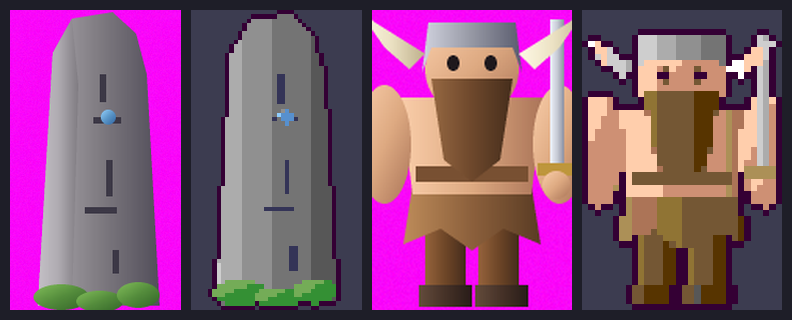

# 16 - Art direction and the AI asset pipeline

AI image generators are good at producing a nice picture and bad at producing a picture that **fits your game**: wrong
size, smooth edges, thousands of colours, a background you do not want. The art pipeline is the bridge. You generate
anything; code makes it look like it belongs.



*Left of each pair: what an image generator gives (here, a stand-in drawn by `tools/make-sample-raw.ts`). Right: what the
game gets after `npm run import-art`.*

## The folders
| Path | What |
|---|---|
| `docs/art-style.md` | The rules: sizes, palette, outlines, shading, mood of each place. Read this first. |
| `art/palette.hex` | A fixed 32-colour palette of Mega Drive colours. Not used by default any more (see "Choosing the palette"); an asset can ask for it with `palette: shared`. |
| `art/prompts/fragments.yml` | Reusable prompt text: the shared style line and a brief per character. |
| `art/assets.yml` | Every picture the game needs: its type, size, where it goes, and its prompt. |
| `art/raw/` | The pictures you generate (input of the pipeline). |
| `tools/gen-image.ts` | Prints the prompts, or generates the pictures if an image service is configured. |
| `tools/import-art.ts` | Runs the pipeline. |
| `tools/art/pipeline.ts` | The cleaning steps themselves: small pure functions, each unit-tested. |

## The workflow
```
npm run gen-image                  # see the prompt for every asset without a raw picture
  ... generate a picture, save it as art/raw/<asset>.png  (flat magenta #FF00FF background!)
npm run import-art -- standing_stone
npm run dev                        # look at it
```
`npm run import-art -- --list` shows which assets have a raw picture. To let `gen-image` call a service for you, copy
`.env.example` to `.env` and fill in `IMAGE_API_KEY` (any OpenAI-style image API works; see `tools/art/imageApi.ts`).
Each picture is requested in a shape that suits it (wide for backgrounds, portrait for the 3x4 character sheet, square for the
rest). An asset can say `gen_size: "1024x1536"` in `art/assets.yml`, and `IMAGE_SIZE` in `.env` forces one size for all.
`npm run sample-raw` redraws the two stand-in pictures used to demonstrate the pipeline.

## What the pipeline does, step by step (`processFrames`)
1. **Cut out.** The generator was asked for a flat magenta background. `chromaKey` makes everything close to magenta
   transparent. Generators never give a perfectly flat colour, and the edges blend with the figure, so it also removes
   anything *leaning* magenta, and one more layer of pinkish fringe around the figure.
2. **Crop to content.** One box around **all frames together** (not each frame alone): a walking frame with a leg stretched
   out must stay where it is relative to the standing frame, or the character would jitter.
3. **Choose the palette.** Each picture gets its own small palette, picked to suit it (see below), from **all frames of a
   sheet together** so a character keeps the same colours in every frame.
4. **Shrink and snap.** By one common factor, so the box plus its outline fits the target size. Three methods (`method:` in
   `assets.yml`): `dominant` (the default) gives every new pixel the palette colour that most of its source pixels have,
   so it never invents a blend, thin dark lines survive (dark pixels count a little extra) and colours stay clean.
   `box` averages everything it covers and then snaps (smoother, but a red wound next to green skin turns into brown mud).
   `nearest` copies one source pixel per new pixel (crisp, only right when the source is already tiny pixel art).
5. **Remove specks.** Lonely single pixels left over from the cut-out.
6. **Outline.** One pixel of dark plum around the figure. Outlines are the single biggest part of the arcade look.
7. **Place.** Put it on a canvas of exactly the size the game expects, feet on the bottom edge (icons: centred).

### Choosing the palette (`buildPalette`)
The first version snapped everything to one fixed 32-colour palette. It looked bad on real generated art: a zombie wants
five greens and the fixed palette had three, a sunset wants a dozen oranges and had five. Real Mega Drive pictures did not
share one palette either; each used a few colours chosen for it. So now each picture gets its own, **16 colours for sprites
and 32 for backgrounds** (`colors:` in `assets.yml` changes that), and every colour is still a real Mega Drive colour (each of
red, green and blue is one of 8 levels), which keeps the whole game looking like one console.
How: count the colours of the picture, split them into the wanted number of groups ("median cut": keep halving the group
with the most variety), nudge each group's colour towards the average of what is nearest to it ("k-means"), snap to the Mega
Drive levels. Counts are square-rooted first so a small but distinctive area (red wounds, a glowing gem) still gets a colour.

### Backgrounds
Backgrounds skip the cut-out and outline. Generators do not make 320x144 pictures (that is 20:9), so the picture is first
**trimmed** to that shape (never stretched; `focus: 0` keeps the top, `1` the bottom, default the middle), then shrunk and
snapped like a sprite. **Dithering** (nudging each pixel by a repeating pattern, so a smooth sky becomes a fine checkerboard
of two colours) is available with `dither: true` but off by default: on a whole scene it showed as a screen-door pattern
over everything.

Sheets (the player) are cut into a grid first, processed as one set of frames, pasted back together, and a Phaser-style
**atlas** file (`grognak.json`: where each frame is, plus named animations such as `walk_e`) is written next to the picture.
The game does not read the atlas yet; Step 17 will use it for animation.

## The tests
- `tools/art/pipeline.test.ts`: every step on tiny hand-drawn pictures (a known colour snaps to the expected palette colour, a palette keeps a tiny distinctive area, shrinking never blends,
  a grid slices into N frames and composes back identically, the outline touches only the edge...).
- `tools/art/art.test.ts`: the **palette test**. Every asset that has a raw picture (so, was imported) must stay within its
  colour budget, use only Mega Drive colours, have no half-transparent pixels, and have the size the game expects. The prompt expansion and the image-service
  request are tested with a fake service. `npm run validate` still checks that the files exist and fit.
- `tests/e2e/art.spec.ts`: the imported stone and Grognak sheet really load and show in the game.

## What ships in this step
- `standing_stone` is now a sprite in the plain (an imported picture, in front of the placeholder background).
- `grognak.png` is the imported character sheet. Both come from stand-in raw pictures, not from a real image generator: I
  cannot generate images, so `tools/make-sample-raw.ts` draws them (smooth shapes, off-palette colours, noisy magenta
  background, 4x too big, like generator output). Replace `art/raw/standing_stone.png` and `art/raw/grognak.png` with real
  generated ones and import again.

## Limits
- The walk frames of the stand-in sheet differ little; a real generator sheet will do better. Consistency across frames is
  the hard part of AI art, which is why Step 17 keeps frame counts low.
- Placeholder pictures (backgrounds, other sprites, icons) are still the generated tiles; they are replaced scene by scene in Step 17.
- `gen-image` has not been run against a real service (there is no key here); it is tested with a fake one.

## Lessons from the first real pictures
- **Pictures with a wide shape need a wide box.** A zombie lying down is about 6 times wider than tall; in a 40x30 box it
  came out 8 pixels high. `zombie_down` is now 60x24 and `zombie_standing` 48x64 (arms stretched out make it wide too).
  When a figure looks too small, the box in `assets.yml` is usually the reason, not the picture.
- **Small is small.** At 40x60 a face is about 8 pixels wide. Ask the generator for big, simple shapes, and expect faces and
  fine details to be suggestions rather than drawings.
